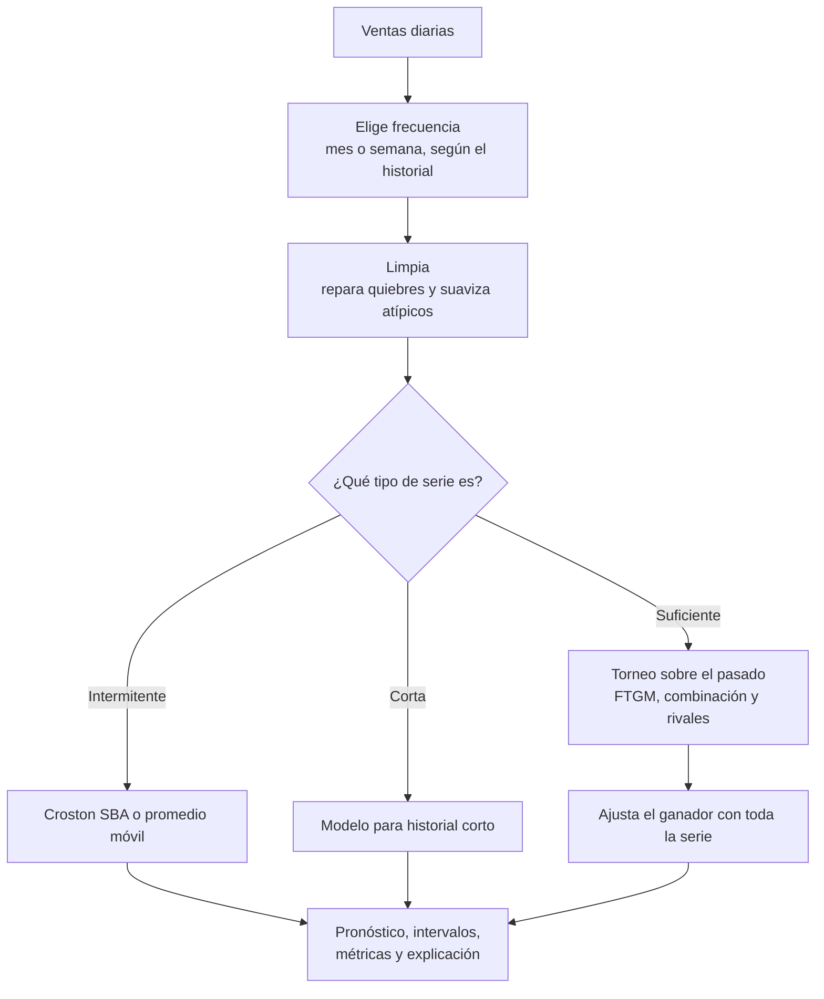

# bria. · motor de pronóstico

Servicio que estima la demanda de cada producto de **bria.** a partir de su historial de ventas. Recibe series por producto, las limpia, compara varios modelos con el pasado de cada serie y devuelve un pronóstico con intervalos de predicción, métricas y una explicación de lo que hizo.

Parte del **Fourier Time-Varying Grey Model (FTGM)**, en su formulación integral (Apéndice A) de:

> Ye, L., Xie, N., Boylan, J. E., & Shang, Z. (2024). *Forecasting seasonal demand for retail: A Fourier time-varying grey model.* International Journal of Forecasting. https://doi.org/10.1016/j.ijforecast.2023.12.006

La idea central: un modelo gris funciona con pocos datos, y aquí sus dos parámetros cambian en el tiempo mediante series de Fourier, para capturar una estacionalidad y un crecimiento que varían a lo largo del año. Es lo que suele tener una MYPE: poco historial y demanda estacional.

El detalle matemático y de implementación está en [`docs/README.md`](docs/README.md).

## Cómo trata cada producto



Cada producto se procesa por separado: si uno falla, los demás siguen. Si no se puede pronosticar, responde `status = "skipped"` con el motivo, en lugar de inventar un número.

## Qué responde y qué no

Este servicio solo pronostica. No conoce usuarios, empresas, inventario, ventas como entidad de negocio, permisos ni pagos: eso es de [`bria-api`](https://github.com/bria-app/bria-api). Es **sin estado**: no usa base de datos.

## Contrato HTTP

### `POST /api/v1/forecast`

```json
{
  "model": "FTGM",
  "period": 12,
  "horizon": 6,
  "series": [
    {
      "product_id": "11111111-1111-1111-1111-111111111111",
      "points": [
        { "date": "2023-01-01", "demand": "120.0", "stockout_flag": false }
      ]
    }
  ]
}
```

| Campo | Significado | Límite |
|---|---|---|
| `series` | Productos del lote | Hasta 2000 |
| `points` | Observaciones de un producto | Hasta 5000 |
| `demand` | Demanda observada | Finita y mayor o igual a 0 |
| `stockout_flag` | Marca un quiebre de stock, para no leerlo como falta de demanda | |
| `period` | Periodo estacional: 12 mensual, 4 trimestral, 52 semanal | 1 a 366 |
| `horizon` / `horizon_days` | Lo que se pronostica, en periodos o días | 1 a 104 / 1 a 730 |
| `validation_size` | Tamaño de la validación | 1 a 104 |
| `max_order` | Reduce el orden máximo de Fourier | 1 a 26 |

Si se excede un límite, responde `422` sin repetir la entrada. Respuesta resumida:

```json
{
  "period": 12,
  "forecasts": [
    {
      "product_id": "11111111-1111-1111-1111-111111111111",
      "model": "FTGM",
      "order_selected": 3,
      "points": [
        { "date": "2024-01-01", "predicted_demand": 138.2, "lower_bound": 120.5, "upper_bound": 155.9 }
      ],
      "metrics": { "mae": 8.1, "rmse": 10.4, "mape": 6.7, "mase": 0.62, "rmsse": 0.58 }
    }
  ]
}
```

- `model` es el modelo que se usó de verdad: `FTGM`, `FTGMCombo`, `DampedTrend`, `SeasonalDamped`, `SeasonalNaive`, `CrostonSBA`, `MovingAverage` o `None` si se omitió. El `model` de la solicitud es solo informativo.
- `order_selected` es el orden de Fourier elegido; `0` indica un modelo de referencia.
- Las métricas de `metrics` miden el ajuste dentro de la muestra y pueden ser `null` cuando no están definidas.

### Otros endpoints

| Endpoint | Qué devuelve | Público |
|---|---|---|
| `GET /health`, `GET /api/v1/health` | Estado del servicio | Sí |
| `GET /api/v1/config` | Umbrales del proceso, para que la API no los duplique | Sí |
| `POST /api/v1/forecast` | Pronóstico | Exige `X-Engine-Key` si `ENGINE_API_KEY` está definida |

## Arranque

Para levantar el sistema completo, usa [`bria-local`](https://github.com/bria-app/bria-local). Para trabajar solo en el motor, con Python 3.11 o superior:

```bash
python -m venv .venv
```

Activa el entorno con `.venv\Scripts\activate` en Windows o `. .venv/bin/activate` en Linux y macOS. Luego:

```bash
pip install -e ".[dev]"
```

```bash
uvicorn app.main:app --port 8010 --reload
```

| Variable | Para qué |
|---|---|
| `ENGINE_API_KEY` | Clave compartida con la API. Vacía, el motor queda abierto: úsalo así solo en desarrollo |
| `APP_ENV`, `APP_DEBUG` | Entorno y detalle de los registros |

## Pruebas y calidad

```bash
pytest tests -q
```

```bash
ruff check .
```

```bash
mypy --strict app
```

Las pruebas cubren el núcleo numérico, el servicio de punta a punta, el contrato HTTP y el torneo. Las de `tests/test_paper_data.py` usan datos reales del M5 y se omiten solas si no están: este repositorio no los trae por su tamaño y su licencia. Para ejecutarlas, descarga los archivos del [repositorio de los autores](https://github.com/yll-66/ftgmmodel) y deja `sales_data1.csv` en `docs/ftgmmodel/`.

## Estructura

```text
app/
├── ftgm/              Núcleo numérico, sin dependencias web
│   ├── fourier.py     Base de Fourier y parámetros a(t), b(t)
│   ├── model.py       Ajuste por mínimos cuadrados e integración con SciPy
│   ├── order_selection.py   Selección del orden de Fourier
│   ├── cleaning.py    Limpieza de atípicos
│   ├── preprocessing.py     Agregación e imputación de quiebres
│   ├── validation.py  Validación sobre el pasado
│   └── metrics.py     MAE, RMSE, MAPE, MASE y RMSSE
├── baselines/         Modelos rivales y de referencia
├── application/       forecast_service.py: el proceso por producto
├── presentation/      Contrato HTTP y endpoints
├── config.py          Configuración
└── main.py            Punto de entrada
docs/README.md         Documentación técnica
tests/                 Pruebas
```

## Cómo leer la precisión

La precisión sobre ventas pasadas es una **estimación optimista**, útil para comparar modelos y no como promesa:

- Se calcula sobre el total del horizonte, así que un mes sobreestimado y otro subestimado se compensan.
- Se compara contra la serie limpia, no contra la venta observada: los picos recortados no cuentan como error.
- El ganador se elige en los mismos cortes en que luego se informa su error.
- Si el FTGM queda a menos de 3 % del mejor rival, gana el FTGM. Por eso el conteo de productos donde gana conviene leerlo con cautela.

## Despliegue

Va en Railway con `Dockerfile` y `railway.json`. La guía completa está en [`bria-local/docs/DESPLIEGUE.md`](https://github.com/bria-app/bria-local/blob/main/docs/DESPLIEGUE.md).

Proyecto de tesis de Ingeniería de Software, UPC (TP2026010042). Uso académico: el código no se distribuye con licencia abierta.
